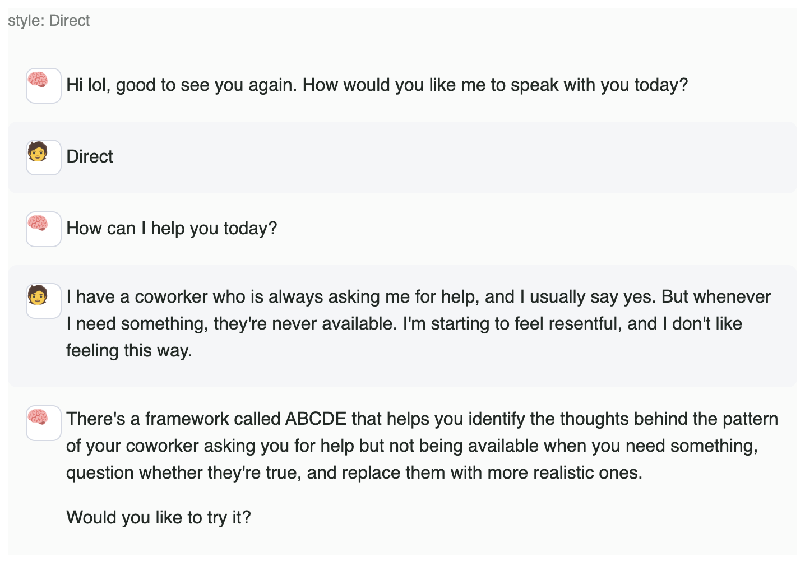

# MANI offered ABCDE after the first message

- **From:** Lolly (client)
- **To:** muhammad
- **Received:** 2026-10-12
- **Requirements drawn from it:** [R1](../requirements.md#requirements)

## Message (verbatim)

> Good morning Muhammad,
> I just started a new Direct test about feeling resentful toward a coworker, and MANI went straight into the ABCDE framework after my very first message, without any conversation. (See screenshot below)
> This is a serious issue. MANI needs to listen, understand what the person is experiencing, and allow a natural conversation to develop before determining whether a framework is appropriate.
> I cannot continue testing when MANI skips the entire conversational experience and immediately offers a framework.
> This needs urgent attention. Please let me know what's causing this and when it will be corrected so I can resume testing.
> See below (image attached)

## Attachment

Transcription of the screenshot (chat-tester, `style: Direct`):

| Speaker | Text |
| ------- | ---- |
| MANI | Hi lol, good to see you again. How would you like me to speak with you today? |
| User | Direct |
| MANI | How can I help you today? |
| User | I have a coworker who is always asking me for help, and I usually say yes. But whenever I need something, they're never available. I'm starting to feel resentful, and I don't like feeling this way. |
| MANI | There's a framework called ABCDE that helps you identify the thoughts behind the pattern of your coworker asking you for help but not being available when you need something, question whether they're true, and replace them with more realistic ones.  Would you like to try it? |
