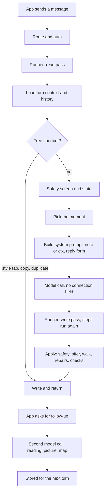
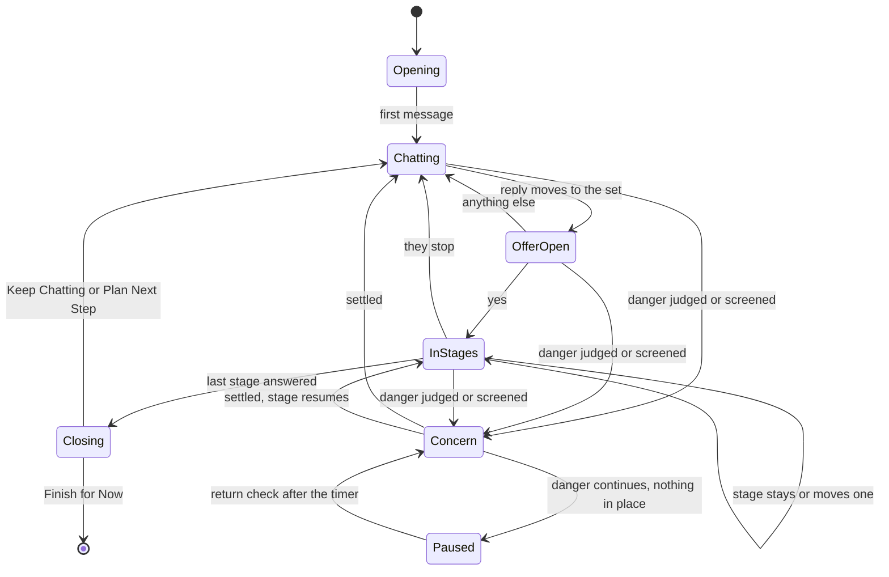
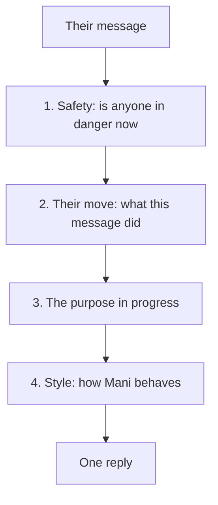

# 0008: One conversation, several moments

- **Status:** draft for muhammad's confirmation. No code, prompt or Decision in force is changed by this document.
- **Date:** 2026-11-16. Sections 11 to 14 were rewritten the same day on muhammad's objection to the first draft
  (code reacting to each kind of message is still scenario-by-scenario coding): code now keeps guarantees only.
- **Source:** Lolly's two Directive tests of 2026-11-16: the
  [boss test](../../client/messages/2026-11-16-directive-boss-abcde-test.md) and the
  [safety test](../../client/messages/2026-11-16-directive-safety-test.md), recorded when muhammad pasted them a second
  time. The safety chat as pasted stops before the sleeping pills and the pop-up; its points 28 to 49 have no chat
  behind them in the repo. Requirement rows R82 to R90.
- **Would change, if approved:** the Decisions in force "Every chat reply ends on one question" (2026-11-10 and
  2026-11-11), "Every question earns its place" (the coverage gate part, 2026-11-06), "a stage their words already
  answer is said back and confirmed once" (2026-10-13), the offer timing decisions (the five-message floor, the
  cooldown counts), and the crisis pause decisions of 2026-11-13 and 2026-11-14.

## How to read this

Sections 1 and 2 say what I understand the goal and the words to mean. If either is wrong, the rest is wrong, so
those are the ones to correct first. Sections 3 to 8 describe the system as it is today, with the files at each step.
Sections 9 to 14 are the diagnosis, the target design, the code that would go, and the decisions that need a yes or
no.

What this rests on: I read `voice.md`, `conversation.md`, `framework.md`, `moments.md`, `abcde.md`, and
`converse.py`, `context.py`, `walk.py`, `runner.py`, `safety.py`, `pause.py`, `crisis.py`, `understanding.py` in
full, the two halves of `orchestrator._turn` and `_converse`, the reply shapes in `schema.py`, `PORT-STATUS.md`
(service map, the decisions cited here, measurements), `requirements.md` (the rows cited), and nine journal notes.

What was run: later the same day I ran the pure functions (`walk`, `converse`, `safety`, `pause`, the reply forms)
on the exact messages from Lolly's chats. [review.md](review.md) lists each claim, what came back, the two claims
that were wrong, which of the client's points the design fixes for certain and which only the model can, the edge
cases, and a decision record for the reading after the reply. Its corrections are applied below.

What it still does not rest on: I had no turn trace for either of Lolly's threads, so which gate held a given chat
turn is inferred. I ran no test suite (the venv is a macOS build and my shell is Linux) and no live turn. I cannot
see what production runs; `origin/main` is the merge of PR #56.

## 1. The goal, as I understand it

One sentence: **a person should feel that one attentive companion is with them from the first message to the last,
and every step that companion takes should have a reason the person could feel**, whether Mani is listening, working
through a framework with them, or keeping them safe.

In the client's own words, which I take as the acceptance test:

- "Entering the framework does not end the conversation. The framework becomes the deeper conversation, with
  structure and purpose." (styles document)
- "Directive leads. Supportive accompanies. Reflective mirrors and explores." "Same MANI. Same framework. Same
  cadence. Different conversational behaviour." (styles document)
- "It needs to be fluid, it needs to be open until the user feels they got to say whatever they want." "We're not
  looking for perfection. We're just looking to be understood." (meeting, 2026-11-05)
- "MANI was moving through steps instead of having a meaningful conversation." (boss test)
- "MANI is confusing safety procedures with caring for a person. It needs to do both." (safety test)

What muhammad asked for on top of that: fully dynamic, yet still a proper cadence where each step has its own
purpose; the styles and the things that override them working at the same time without reading as robotic; context,
reply fields and stored state that fit each step; and frameworks that read as conversation with a purpose, not a list
of questions.

So "dynamic" does not mean no structure. It means the structure is a set of **purposes** Mani serves, and what the
person just said can always interrupt, slow or redirect the step in progress.

## 2. Vocabulary

| Word | Meaning here |
|---|---|
| Open chat | Everything before a framework is offered and after one ends. Its job is that the person feels heard and Mani understands what the trouble is. It is not an intake form for the framework. |
| Framework | A set of stages (ABCDE, Thought Reframe) the person agreed to. Its job is a new way to see the thing and something to do. To the person it is still the same conversation. |
| Moment | What the database says is happening on a turn: `chatting`, `check_open`, `offer_open`, `in_stages`, `body`, `concern` (`schema.Moment`). Code picks it; it picks the prompt part and the reply form. |
| Safety layer | The judgment, every turn, of whether anyone is in danger now, and what Mani does about it. Today it is one of the moments. I argue below that it should be a layer over all of them. |
| Style | Directive, Supportive or Reflective. Chosen once per conversation. It changes how Mani behaves in a reply, never what is true about the person or where the conversation is going. |
| Their move | What the person's newest message did: answered, added, said there is more, asked Mani something, corrected or got frustrated, asked for help, wants to stop, or spoke of danger. This is the piece the design below adds. |

## 3. A turn today, step by step

| # | Step | Decided by | Files | Database |
|---|---|---|---|---|
| 1 | Route, auth, chat-open gate | code | `mani/routers/messages.py`, `routers/threads.py`, `auth/deps.py`, `auth/jwt.py` | reads `chat_pauses` |
| 2 | Read, think, write. The steps run once up to the model call and roll back, the model is called with no connection held, then the steps run again and write | code | `chat/runner.py`, `one_at_a_time.py`, `prompts/cache.py` | two short transactions |
| 3 | Idempotency key, pause refusal, one writer per thread | code | `orchestrator._turn` (top), `db/pauses.py`, `db/messages.py` | advisory lock |
| 4 | Load the turn context and the history window (40,000 characters) | code | `db/threads.load_turn_context`, `chat/rewind.py`, `db/messages.for_context` | `threads`, `profiles`, `thread_technique_state`, `thread_summaries`, `user_memory`, `chat_pauses`, `messages` |
| 5 | Shortcuts with no model call: the style tap, their message being Mani's last reply pasted back, a retried send | code | `orchestrator.chosen_style`, `_open_in_style`, `_copied_back`, `chat/greeting.py` | writes the pair |
| 6 | Safety as the message arrives: phrase screen, thread state, return check after a pause | code | `chat/safety.py`, `chat/pause.py` | `threads.safety` |
| 7 | Pick the moment. First match wins: concern, body, in stages, offer open, check open, chatting | code, from stored state | `context.moment`, `context.live` | none |
| 8 | Build what the model reads | code assembles, people authored | `prompts/composer.py` (`compose_conversation`, `compose_framework`, `compose_moment`), `converse.note` for chat, `context.build` for every other moment; content from `content/prompts/*.md` and `content/frameworks/*.md` through `scripts/seed.py` | `admin.prompts`, `admin.frameworks` (cached) |
| 9 | Pick the reply form | code | `schema.conversation_reply_for`, `schema.reply_for` | none |
| 10 | The reply | **model** | `llm/client.py`, `llm/chain.py` | `admin.llm_calls` |
| 11 | Apply the reply: safety judgment, pause, offer answer, understanding merge, stage walk, body route, repairs, counted checks | code | `orchestrator._judged`, `safety.after`, `pause.pauses_now`, `converse.replied`, `understanding.merge`, `walk.py`, `chat/body.py`, `chat/repairs.py`, `chat/reply_checks.py` | none yet |
| 12 | Write everything together | code | `db/messages.create_pair`, `db/threads.apply`, `orchestrator._record_danger`, `_pause_writes`, `db/turn_traces.py` | `messages`, `threads`, `thread_technique_state`, crisis events, `chat_pauses`, traces |
| 13 | After the reply is shown, the app asks for the follow-up: the reading of the person, the picture, the map of what is explored, the summary | **model**, then code | `routers/messages.py` (`follow_up`), `orchestrator.follow_up`, `read_understanding`, `converse.read`, `summarize.py` | `threads.understanding`, `thread_summaries` |
| 14 | Later: quiet chats folded into memory | **model** | `memory.py`, `catch_up.py`, `routers/cron.py` | `user_memory` |

## 4. The moments and what overrides what

The order in `context.moment` is the override order today: **concern beats everything, then the body route, then a
running framework, then an open offer, then an open check, then chat.** Two things follow from that being a
first-match switch:

1. **A moment is exclusive.** A concern turn is only a safety turn. A stage turn is only a stage turn. There is no
   turn that is "mostly comfort, with one safety question" or "answer her frustration, and leave the stage for now",
   except where a prompt sentence asks for it.
2. **Style is not in the order at all.** It is a paragraph of `voice.md` plus one style-resolved `ask` line per
   stage. Nothing gives Directive, Supportive or Reflective a different job on a turn.

## 5. Where the AI is, and what it is asked to decide

| Call | When | Reads | Returns | Files |
|---|---|---|---|---|
| Reply | every paid turn | system prompt (voice plus one part), history window, their message, the note or `[ctx]` | a structured reply | `orchestrator._converse`, `_turn` |
| Reading | after a chat or stage reply, when the app asks | the same prompt and history plus the reply | `reading` (14 fields), `picture` (17 fields), `exploration` (3) | `orchestrator.read_understanding` |
| Summary | when messages leave the window | the thread | summary, techniques tried | `summarize.py` |
| Memory fold | when a chat goes quiet | the thread | patterns about the person | `memory.py` |
| Speech to text | on a voice message | audio | text | `stt.py`, `routers/transcribe.py` |

The reply is a form. `ConversationReply` has 22 fields (`safety` with 6 inside it, `heart`, `need`, `needs_info`,
`info_needed`, `shape`, `window`, `insight`, `insight_from`, `link`, `move`, `progress`, `plan`, then `text`, then
`forward`, `core`, `checking`, `prepared`, `asked_for_help`, `frustrated`, `back_to_framework`, `title`). A stage
turn's form has 14 (`schema.reply_for`). The chat system prompt is `voice.md` (23,016 characters) plus `conversation.md`
(35,279); the journal recorded about 6,000 static tokens on 2026-10-12, so it has more than doubled while the rule
was "cut, never add".

| Decision | Who decides today | Note |
|---|---|---|
| Is anyone in danger now | model, held by code (a refusal never lowers it) | sound |
| Which moment this turn is | code, from stored state | exclusive, see section 4 |
| What kind of reply the turn needs | model (`shape`, `move`) | then code adds a question regardless |
| Whether the reply ends on a question | **code, always yes** (provider pattern on `forward`) | the client has objected three times |
| When the offer may come | code: 5-message floor, core named, four areas explored, cooldowns | areas come from the late reading |
| Which framework | model, from two active ones | both examine a belief |
| Whether a stage is answered | model (`stage_answer`), checked by code | no value for "there is more" |
| The words of the offer, letter lines, buttons, pause reply | code, fixed text | client's wording for the offer, ours for safety |
| Whether they are frustrated | model reports it, **nothing reads it** | `orchestrator.py` line 572 |
| The pause | code, from the model's read | replaces the model's reply |

## 6. Each flow: purpose, happy path, where it breaks

### 6.1 Opening and style

Purpose: greet, let them choose how Mani speaks. Happy path: `GET /v1/threads/opening`, a tap, the style's opener, all
without a model call. Files: `routers/threads.py`, `chat/greeting.py`, `orchestrator._open_in_style`,
`context.resolve_style`. No failure seen in the two tests.

### 6.2 Open chat

Purpose (the client's): they settle, feel heard, and Mani understands what the trouble is, in roughly two to four
exchanges, "a range, not a required count", and "less question-heavy".

Happy path: they say what happened, Mani stays with it, asks only what it does not know, says its reading of the heart
of it back, they confirm or correct, Mani offers.

Where it breaks, with the boss chat as evidence:

- She had stated the whole problem by her second message. Mani asked six more questions. Two things make that
  certain whatever the model thinks: an offer is impossible before her fifth message (`context.CHECK_FROM`), and
  every chat reply must end on a question (the pattern on `forward`). So at least four questions come before any
  offer, however clear the problem is. The client's own document says two to four exchanges, "a range, not a
  required count".
- After the floor, the model's own judgment that the heart of it was not named held the move, as it did on 40 of 49
  held turns in muhammad's chats (branch note of 2026-11-12). The area gate (`converse.EXPLORED_BEFORE_MOVING`) held
  the other 9, and it works only once a reading has landed: with no map it is off. I first blamed it for all six
  questions; [review.md](review.md) corrects that.
- After her "yes", the note's own line told the model to ask "what they fear losing" (`converse.gaps`; reproduced).
- When she said "you asked me this already", the reply was the framework offer. A move allowed and not made is due
  on the next reply, and the note for a due move has no exception for frustration (reproduced).

Files: `orchestrator._converse`, `chat/converse.py`, `chat/context.py` (`may_check`, `journey`), `chat/picture.py`,
`chat/understanding.py`, `content/prompts/voice.md`, `conversation.md`, `chat/repairs.py` (`transition_offer`).

### 6.3 The offer

Purpose: ask permission, in the client's words, naming the belief. Happy path: the client's template with the core in
it, three buttons, a tap or a typed yes. Files: `repairs.transition_offer`, `repairs.offer_buttons`,
`orchestrator._offer_answer`, `_answered_offer`, `content/frameworks/*.md` (`offering`).

Where it breaks: it can arrive as the answer to frustration (above), and with only ABCDE and Thought Reframe active
it always frames the trouble as a belief to examine, also when the trouble is a boss who yells.

### 6.4 The framework walk

Purpose (the client's): "the deeper conversation, with structure and purpose".

Happy path: each stage does something the chat did not. The person sees the link from what happened to what they
tell themselves to what it does to them, looks at both sides, and leaves with their own new view and one thing to do.

Where it breaks, with the boss chat as evidence:

- A stage the chat already answered is "said back and confirmed once", one stage per reply, with an invitation to add
  (`walk.CONFIRM_ASK`). With A, B and C all known that is three turns of "here is what you said, anything else?",
  which she had already objected to twice in the chat.
- "All the things you mentioned and I am sure more" moved the walk, because `stage_answer` describes "agreed" as
  "with or without more added" and `walk.advance` reads "yes, and more" as agreement.
- Staying to go deeper is nearly unreachable. The schema says `explore` holds a stage "for one reply" and only when
  the answer is unclear, and `walk.advance` turns `explore` into `answered` on a stage that was asked rather than
  said back. The Decision in force says the opposite ("a stage stays while a part not yet opened would help").
- The next stage's letter line is put in front of text that begins by answering the previous stage: "B is for Belief.
  Right. The disrespect itself is the issue."
- D opened on the challenge side because the chat was counted as already holding what supports the belief.
- The rule that holds a stage when their message asks something is a regex on its first word. "How he treats me",
  a plain answer, is held as a question (reproduced).

Files: `chat/walk.py`, `orchestrator._walked`, `context._running_lines`, `_stage_lines`, `content/prompts/framework.md`,
`content/frameworks/abcde.md`, `thought_reframe.md`, `schema.Reply`.

### 6.5 The close, Plan Next Step, the body check-in

Purpose: carry their new view and their one step forward; offer to prepare it; let them leave. Happy path: a warm
close with no question, then Keep Chatting, Go to Library, Finish for Now, with Plan Next Step first when something
practical is ahead. The body check-in is paused. Files: `chat/body.py`, `walk.next_line`, `context._MEANING`
(`follow_through`, `body_step`), `content/prompts/somatic.md`. Not exercised by either test.

### 6.6 Safety, the pause, the return check

Purpose (the client's): "respond with care while asking clear, necessary safety questions", and for an overdose
"respond immediately and clearly as a medical emergency".

Happy path: words that may mean danger get one plain, warm question; what they answer decides; real danger gets the
one thing that keeps them safe, and Mani stays.

Where it breaks, with the safety test as evidence:

- The first reply to "I do not want to live anymore" already carried the emergency number, because since PR #54 every
  ordinary chat note includes `context.DANGER_DIRECTION`.
- Seven replies in a row ended on a safety question. A safety reply is asked for a question by its form's instruction
  and code appends it, the unsure guidance says frustration "changes how you ask, never whether it is settled", and
  she never answered directly.
- The phrase screen matched none of her messages: not "I do not want to live anymore", not "I see no other way out",
  not "I took sleeping pills" (reproduced). Had the model call failed on any of them she would have got an error.
- There are three states: clear, unsure, danger. "Yes I am" (thinking of ending her life, no plan said) still sits in
  unsure, whose guidance is "you do not know yet".
- The list of questions already asked is not sent on a concern turn (`context.build` sends it only while a framework
  runs).
- When she said she was still chatting after the pills, code discarded Mani's reply, sent a fixed line and locked the
  chat for 15 minutes (`pause.pauses_now` since PR #56, `crisis.pause_reply`).
- The pop-up is one static text. The API sends only `paused_from` and `paused_until`, so the app cannot tell an
  overdose from a threat to someone else, and 988 always leads.

Files: `chat/safety.py`, `chat/pause.py`, `chat/crisis.py`, `context._MEANING["safety"]`, `content/prompts/moments.md`,
`schema.SafetyRead`, `db/pauses.py`, `routers/crisis.py`, `models/api.py`, `chat-tester/crisis_pause.py`.

### 6.7 The reading after the reply, summary, memory

Purpose: keep what Mani understands between turns without making the person wait. Happy path: the app asks, the
reading lands before their next message.

Where it breaks: the reading takes a median of 16 to 20 seconds, and on Vercel nothing runs after a response, so it
runs only when the app asks and only the chat tester does. How often it lands late depends on how fast the person
types: 80 of 138 production turns in the 2026-11-10 audit, 6 of 163 in muhammad's own chats, 3 of 29 in manasa's. It
is a second writer on the same record with no fixed order, so a late one can undo what a newer reply wrote, and one
that lands while the next reply is being written can change that reply's form between the runner's two passes and
get the turn refused ("Mani is still answering your last message"; 3 of 4 fast-paced runs on the unmerged branch).
The decision record in [review.md](review.md), section 5, proposes one call and one writer.

Files: `orchestrator.read_understanding`, `follow_up`, `converse.read`, `summarize.py`, `memory.py`, `catch_up.py`.

## 7. The same event, handled differently depending on the moment

This table is the centre of the diagnosis. Each row is something a person can do on any turn.

| Their move | In open chat | In a framework stage | On a safety turn |
|---|---|---|---|
| Asks Mani a question | prompt sentence only | **code holds the stage** (`walk.held_by_question`) | nothing; "what do you mean" was answered and the question re-asked |
| Is frustrated or corrects Mani | reported, read by nothing; an offer can still fire | prompt: stay, `not_yet`; `framework_fit` can offer to step out | "changes how you ask, never whether it is settled" |
| Says there is more | prompt: "Is there more?" | read as agreement, the walk moves | not handled |
| Asks for help or what to do | one small idea, then pressed toward the framework | suggestions at E | not handled |
| Wants to stop or says goodbye | a question is still required | `stop`, the framework is declined | "never end the conversation" |
| Gives a one-word answer | counted as quiet; two press toward the framework | `not_yet`; two stalls offer to step out | not handled |
| Speaks of danger | the turn becomes a safety turn | the stage pauses and resumes later | stays a safety turn |
| Brings another problem | the reading starts again | asked which to stay with | not handled |

One event, three behaviours, each added after a different failed chat. That is why Mani feels like a different
character in the chat, in the framework and in a crisis, which is the client's point 57 ("does not maintain a
consistent voice") and point 12 of the boss test ("followed the framework instead of the conversation").

## 8. State and context today

| Where | What | Written by |
|---|---|---|
| `threads.safety` | clear, unsure, danger | every turn's judgment |
| `threads.understanding` (JSON) | about 20 keys merged by hand: `feeling`, `heart`, `case`, `picture`, `plan`, `thinking`, `insights`, `progress`, `exploration`, `toward_framework`, `corrected_offer`, `follow_through`, `preparing`, `safety_settled`, `safety_end_check`, `danger_reached`, `danger_about`, `return_check` | `converse.replied`, `converse.read`, `understanding.merge`, `orchestrator._safety_record`, `walk` through the orchestrator |
| `threads.check_at_message_count`, `message_count` | offer timing | `threads.apply` |
| `thread_technique_state` | framework, outcome, phase, `stages_known` per stage (said, status, gap, covered, explored, stalls, exit_offered) | `walk`, `threads.apply` |
| `chat_pauses` | start, end, reason, checked_at | `orchestrator._pause_writes` |
| `thread_summaries`, `user_memory` | compressed history, patterns | `summarize.py`, `memory.py` |
| the pending follow-up on the thread | the reading still owed | `threads.set_pending_follow_up` |

What the model is sent per turn: in chat, a system note of up to twenty-odd lines built by `converse.note`; in every
other moment a `[ctx]` block built by `context.build`, with a "means" line under each value.

Three observations:

1. **No single shape.** The understanding record has no type; four modules add and remove keys. Safety facts live in
   it next to conversation facts.
2. **Nothing records what was asked and what was answered.** The chat is shown its last six questions as text. A
   safety turn is shown none. So "did I already ask this, and did they answer" is re-derived from the transcript by
   the model every turn.
3. **Two writers, no order.** The reply and the reading both write this record, and the gates behave differently
   depending on whether a reading has landed.

## 9. Root causes

Five, all in the design. None is a typo or a stray line.

1. **Moments are exclusive modes, and each mode has only its own job.** The person's move (section 7) has no place
   that every mode shares, so each mode answers it in one sentence and goes back to its task: the next area in chat,
   the next stage in a framework, the next risk question in safety. This is "moving through steps instead of having a
   meaningful conversation" and "confusing safety procedures with caring for a person", from one cause.
2. **Every way out of a reply is a question.** In chat by a provider-enforced pattern; on a stage that stays and on a
   safety turn by the form's instruction, with code appending it. A reply cannot simply stay with someone, close, or
   give something and stop.
3. **Progress is measured by counts and coverage.** No offer before the fifth message; then four areas to be touched;
   a stage is "answered" when its minimum is met. The floor guarantees at least four questions before any offer, and
   the minimum is why stages pass in one turn each.
4. **The reply is a form of about thirty fields, and the prompt is about 58,000 characters plus a per-turn note.**
   The fields were each added to fix one chat. Together they make the model reason about the form. Several rules now
   contradict each other (A's "ask whether that's the situation" against "never just a yes-or-no question"; "ask
   once" against "never whether it is settled"; "name what went wrong" against "No apology"). The code carries the
   same history: `mani/chat/` and `schema.py` hold 178 dated references, mostly comments tying a rule to the chat
   that caused it, 37 compiled regexes, 60 safety phrases and about a dozen thresholds that decide behaviour
   (counted 2026-11-16).
5. **Style has no behaviour of its own, and Directive has nowhere to lead.** The chat "never tries to fix the
   problem", the only two active frameworks examine a belief, and Structured Problem Solving is paused. The client's
   definition of Directive is "leads the user toward clarity, action, problem-solving, or a next step".

How this matches the journal's failure classes (`failure-classes-from-later-branches-2026-10-21.md`): class 1
(patching one transcript with a rule), class 2 (the prompt grows and its phrases get spoken), class 4 (gates stacked
on the model), class 8 (offering too early, then too late). The cadence was changed on 11-03, 11-05, 11-06 twice,
11-10 and 11-11. By this repo's own patch limit, the next change has to be to the design.

## 10. Performance, from what the repo has already measured

Every number here is read from the repo; I measured nothing. A full performance review is its own piece of work.

| Finding | Evidence | Why it matters to this design |
|---|---|---|
| The wait is the model thinking | 154 production chat calls, 2026-11-01 to 05: p50 9.8 s, p90 19.6 s; about 75% before the first token; latency tracks output tokens (r = 0.94, about 12.4 ms a token). `backend/docs/latency-report-2026-11-05.md`, journal `latency-where-the-wait-goes-2026-11-05` | Every reply field is output tokens. A smaller form is a shorter wait, at about 1.2 s per 100 tokens if that slope still holds. |
| The reading is slow and unordered | p50 20.3 s, p95 56 s, 13 of 91 timed out (audit of 2026-11-10); about 1,500 output tokens, 900 of them reasoning; late for fast typists (80 of 138) and rarely for slow ones (6 of 163). Branch note `reading-lands-late-gates-move-to-the-reply-2026-11-12`, not on main | Anything the next reply must know has to come from the reply itself. See the decision record in `review.md`. |
| Two model calls per turn share 100 slots | Offline load test 2026-11-05: at 500 people 31% of sends got `429`, and 977 readings were refused (`PORT-STATUS.md`, Latest measurements) | Folding the gate-relevant part of the reading into the reply frees slots; the picture can stay a cheaper call. |
| Each turn runs its steps twice across regions | `chat/runner.py` runs the read pass and the write pass; production functions are in iad1 and the database in ca-central-1 (`PORT-STATUS.md`, Open engineering). Not measured. | Not a reason to change the runner. A reason to keep the number of queries per pass in mind. |
| A change of reply form resets the prompt cache | 0 cached tokens in 12 of 15 first calls after a form change (same journal note). Cost, not wait. | One stable form per conversation would stop this. |

Unknown and worth knowing before tuning: today's latency after the 11-05 changes, how often the app's follow-up
request actually arrives, and the output token count per reply by moment. All three are in `admin.llm_calls` and the
turn traces, and reading them is safe on production.

## 11. Target design: one conversation, judged by the model, with few guarantees in code

Revised on 2026-11-16 after muhammad's objection to the first draft of this section: a table where code reacts to
each kind of message, and safety levels as fixed branches, is the same scenario-by-scenario coding in a tidier
form. He is right. This section replaces it.

### 11.1 The rule

**No rule, regex, phrase list, threshold or fallback text is written for a scenario. Code enforces only guarantees:
things that must hold in every conversation whatever the model writes. Everything else is the model's judgment,
from a short prompt of principles, checked by measuring many conversations.**

The test for whether something may live in code: *would it be wrong in every conversation, and can code tell
without reading what the person meant?* If telling needs an understanding of their words, it belongs to the model.

This is not a new direction for the repo. It has been taken twice and held: the phrase router was removed and the
model chooses the framework (`router-removed-model-chooses-the-framework-2026-10-09`), and safety became the
model's judgment held by two code rules (`safety-is-the-models-judgment-2026-11-10`, "the model understood both
conversations; the rules around it overrode that understanding").

It has also failed once, and the reason still holds. The Decision of 2026-10-10 let the model offer "as soon as it
fits", and Lolly got ABCDE in reply to her first message and stopped testing (`offer-window-owned-by-code-2026-10-12`).
The note's finding was that the prompts told the model to offer as soon as one fits, and later that 18 of 18 offers
came at the earliest point the window allowed: the model offers as early as it is told it may. So the wording of the
offer principle decides, the offer is the first thing to measure, and it is the one place where I propose a
structural guarantee (11.3, 2c).

### 11.2 The layers, as the way Mani reasons

The four layers stay, as the order the prompt teaches and the model reasons in. They are not branches in code.

| Layer | The model asks itself | Overrides |
|---|---|---|
| 1. Safety | Is anyone in danger now, and how much of this reply should that take? | everything, in proportion |
| 2. Their move | What did this message do: answer, add, say there is more, ask me something, correct me, ask for help, want to stop, bring something new? | the purpose in progress |
| 3. Purpose | What is this step for, and is it done? | style |
| 4. Style | Directive leads, Supportive accompanies, Reflective mirrors and explores | nothing |

Section 7's three-column table collapses to one column because the same principle is read on every turn: *respond
to what this message did before going on with anything.* A question gets its answer. A correction gets a reply that
is different, not an apology and the same move again. "There is more" gets room. A wish to stop gets a close.

### 11.3 What code keeps: the guarantees

| # | Guarantee | Where it lives today |
|---|---|---|
| 1a | A concern is never lowered by a refusal or by pushing the question away | `safety.after` |
| 1b | A failed model call on any chat turn is answered with fixed words that say how to reach help, never with an error alone | today only while a concern is open or a phrase matches (`runner.run` fallback, `crisis.CRISIS_REPLY`); none of the safety test's messages matched |
| 1c | Help numbers come from the stored list, never from the model, and a turn judged as danger tells the app so | `crisis.RESOURCES`, `routers/crisis.py`, `crisis_detected` in the turn response |
| 1d | The phrase screen can raise a turn to unsure and can never lower one | `safety.screened` |
| 2a | A framework starts only on their yes | `orchestrator._offer_answer`, the offer buttons |
| 2b | A set they declined comes back only when they ask for it | today a six-message count (`COOLDOWN_AFTER_DECLINE`); the count goes, the rule stays |
| 2c | An offer names a reading Mani already said back in an earlier reply | today `heart in NAMED`, read from the reply itself, not from the late reading |
| 2d | The client's fixed wording is rendered by code: the offer, the permission question, the buttons, the letter lines, the body check-in script | `repairs.py` templates, `walk.reply_text` (intro), `chat/body.py` |
| 3 | Stages go in order, at most one forward per reply, none skipped, nothing stored for a stage before it is reached | `walk.start`, `walk.advance` (the step, not the rewrites) |
| 4 | Plumbing: auth and RLS, idempotency, one writer per thread, read-think-write, limits, storage, traces | `runner.py`, `orchestrator._turn` (top), `db/` |
| 4a | What Mani understands of a person has one writer, the turn itself, in the turn's own transaction | not true today: the reply and the reading after it both write it (`review.md`, section 5) |
| 4b | A person cannot type their own `[ctx]` block, and the system's own words never reach them | `context.disarm`, `repairs.strip_script_leakage`, `repairs.without_internal_words` |
| 4c | No dashes in what Mani says: a typographic rule the client asked for, with no judgment in it | `repairs.without_dashes` |

Three of these need muhammad's eye:

- **2c is the only timing rule left in code.** It reads what the model itself reported, never what the person said,
  and it makes a first-reply offer impossible by construction. Say no and it becomes guidance like the rest.
- **The net under a failed model call no longer depends on a phrase list (1b).** I first proposed keeping the screen
  for this. Running it on the safety test's own messages showed it matches none of them, so the guarantee was not
  true. A failed call on any chat turn now gets the words; that needs no list.
- **The phrase screen stays only as a floor (1d)**, the one list that survives, because removing a second look at
  danger is not something to do on an argument. It can be retired by measurement: run its 60 phrases, and
  paraphrases of them, through the model's own judgment in the scenario set, and drop the list if the model flags
  them all. Whether the chat ever locks is decision D5.

### 11.4 What becomes the model's judgment

| Judgment | The principle the model is given | The code that decides it today |
|---|---|---|
| Whether to ask, and what | A question is for something you do not know and need. A reply may end without one. | the pattern on `forward`, `orchestrator._with_forward`, the question added to a stage that stays, the forward added to a safety reply |
| When to offer | Offer once your reading was said back and stood, and they are not in the middle of something else. | `CHECK_FROM`, `EXPLORED_BEFORE_MOVING`, `still_to_explore`, `due`, `naming_due`, the five `MOVE_` and `NAME_NOW` lines |
| What their message did | Respond to what this message did before going on. | `walk.held_by_question` and its regex, `converse.AGREED` and `SAID_YES`, the quiet count and `QUIET_TO_HELP`, `frustrated`, `asked_for_help`, the stall count |
| Whether a stage is done | A stage is done when its purpose is met and their message opened nothing new. Staying is as normal as moving. | `walk._counts`, the answer rewrites inside `walk.advance`, the one-reply cap on `explore`, the known, possible, partial ladder with its fallbacks |
| How much of a reply safety takes | The levels in 11.7, as guidance. | the exclusive concern moment, `safety.danger_of`, `crisis.END_CHECK`, `crisis.pause_reply` |
| What to explore next | Nothing is supplied. The model reads the conversation. | the funnel (`picture.funnel`, `converse.funnel_line`), `converse.gaps`, the worth-exploring lines |
| Not repeating itself | The history is in front of it. | `context.asked_before`, `last_question`, `last_ending`, `copies_last_reply` |

`their_move` stays as one reported field, **for the trace and the scenario counts only**. Code does not branch on it.

### 11.5 Purposes, as guidance

**Open chat.** Not a sequence to complete; the model knows which it is serving.

| Purpose | Done when | Not |
|---|---|---|
| Receive | they have said what they came to say, by their signal, never a count | a summary, an insight, a feeling they did not name |
| Understand | Mani knows what happened, what it means to them and what they want, from their words | asking for what they said; a question to cover an area |
| Say it back | Mani gave its reading as a reading and they confirmed or corrected it | a label; a guess presented as theirs |
| Bridge | they were offered the next thing that fits | an offer as the answer to a correction or to frustration |

**A framework stage.** The stage's `purpose`, `ready_when` and `explore` lists in `abcde.md` and
`thought_reframe.md` are already written as purposes; they stay. What goes is the code that second-guesses the
model's judgment of them. Two structural points, neither about any scenario:

- The reply to what they just said and the opening of the next stage are two fields, so the letter line lands
  between them and never in front of an answer to the previous stage.
- What to do with stages the chat already answered is the client's open question (D3).

### 11.6 Style as behaviour

| | Directive: leads | Supportive: accompanies | Reflective: mirrors and explores |
|---|---|---|---|
| Open chat | gets to what is at stake in few words; once understood, moves toward a next step | stays with the feeling longer before asking anything | links what they said to what they said earlier |
| Framework | "I'll guide you through it one step at a time"; keeps it moving "without rushing" | "one step at a time together"; asks rather than pushes | "let's look at it together"; shows the assumption underneath |
| Safety | same care, plainest words | same care, more warmth | same care, no interpretation |
| Never | a question every turn; a feeling they did not name | repeated reassurance | "I hear you" as a formula; a meaning they did not express |

Safety is the one layer style does not change in substance. The universal rule from the styles document applies in
all three: "MANI does not label, define, or tell the user what they are experiencing." For Directive to lead
anywhere when the trouble is a real situation, the chat needs a practical bridge (D4).

### 11.7 Safety levels, as guidance

A proposal for Lolly to correct. I am not a clinician, and none of the current safety wording has had clinical
review. These are what the prompt would teach, not branches in code.

| Level | Their words | What the reply does |
|---|---|---|
| 0 Distress | pain, hopelessness, "I can't do this", no words about dying or harm | ordinary conversation |
| 1 Unclear | words that may mean dying or harm | mostly stays with them; one plain question, with the reason said kindly |
| 2 Thoughts, no plan | they confirm thoughts of ending their life, nothing about a plan, means or now | stays with what happened to them; says once that a person can help right now; asks once whether they are safe tonight |
| 3 Imminent | a plan, the means at hand, or now | direct and warm: who can be with them, the emergency number, distance from the means; stays |
| 4 Medical emergency | pills taken, a symptom happening now | emergency services first and plainly, why chatting is not enough, one simple thing to do now, said again while it is still true |

Principles for every level: a reply is never only a risk question; a question they answered is not asked again in
other words; when they say Mani has stopped caring, that is answered before anything else. The code side is
guarantees 1a to 1d and nothing more. The app is told the kind of danger with any pause, so its screen can speak to
that person and that situation.

### 11.8 One home for instructions, a smaller form, a typed state

**Instructions to the model live in four places today.** The prompt files (77,421 characters across `voice.md`,
`conversation.md`, `framework.md`, `moments.md`); 133 field descriptions in `schema.py` (about 25,700 characters,
counted by a regex, so approximate); the `[ctx]` meanings in `context.py` (about 244 lines of prose); and the note
and walk constants in `converse.py` and `walk.py` (about 60 lines). The 2026-11-06 decision "one home per rule" was
applied among the prompt files only. Contradictions between homes are how "ask once" met "never whether it is
settled".

Target: principles live in the prompt files and nowhere else. The note and `[ctx]` carry facts about this
conversation (the style, what is stored, the stage and its purpose), never instructions. A field description says
what the field is, in a line. The prompt gets a size budget held by a test, as `mani_base.md` once had; the number
is muhammad's to set.

**The reply form**, the same shape in every moment so the prompt cache holds: `safety`; `their_move` (traced);
the stage judgment while a framework runs (`stage_answer`, `stage_updates`, `next_stage`); `text`, with its question
inside it when it has one; `stage_text` for the opening of a stage just reached; and the slots code renders the
client's wording from (the offer, `body`). The other chat fields go; their reasoning is the model's own, at the
effort already set.

**The stored state** gets one typed model owned by one module, in three parts: what they said, where the
conversation is, and safety. It can stay in the same JSON column.

### 11.9 What goes: a first classification

Basis: `converse.py`, `context.py`, `walk.py`, `safety.py`, `pause.py` and `crisis.py` were read in full.
`repairs.py`, `picture.py` and `reply_checks.py` are classified from their docstrings and `repairs.apply`. Every row
is to be confirmed function by function before anything is deleted, and nothing here is approved.

| File | Goes | Stays | Risk of the removal |
|---|---|---|---|
| `chat/converse.py` | `agreed`, `gaps`, `funnel_line`, `toward`, `still_to_explore`, `move_held_by`, `naming_due`, `due`, `_explored_so_far`; `EXPLORED_BEFORE_MOVING`, `QUIET_TO_HELP`, `GAPS_FROM`, `REPEAT_WORDS`, `FUNNEL_FROM`; the `MOVE_`, `NAME_NOW`, `TOWARD_LINE`, `AFTER_CORRECTION` lines; most of `note` | `note` as facts only, `checked` (guarantee 2c), `case`, `replied` and `read` reduced to storage | **high** for offer timing |
| `chat/context.py` | `may_check` and its three counts, `check_open` (serves only checks stored before 2026-11-03), `asked_before`, `last_question`, `copies_last_reply`; the instruction prose in `_MEANING`, moved to the prompt or cut | `disarm`, `strip`, `live`, `moment` reduced, `resolve_style`, `build` and `_stage_lines` as facts, one condition for guarantee 2b | low, except the safety prose, which moves with slice 5 |
| `chat/walk.py` | `_counts`, `asks`, `held_by_question`, the rewrites in `advance`, `covered`, `after_turn` and `STALLS_TO_STEP_OUT`, `from_picture`, `confirm_phrase`, `_confirm_fallback`, `_gap_line`, `stay_question`, the fallback branches of `reply_text`, `CONFIRM_ASK`, `reach_line`, `next_line` | `content_stages`, `merge`, the one-stage step in `start` and `advance`, the letter line, `ledger_view`, `landed_on` | medium |
| `chat/picture.py` | `funnel`, `explored`, `_covered`, `reconcile`, the quiet count in `merge` | `merge`, `render`, `core`, as storage of what each message adds | low |
| `chat/safety.py` | `danger_of` (a code override of the model's read of a body symptom, from one chat) | `State`, `after`, the screen as a floor (1d) | **high**: the chest-tightness chat is why it exists |
| the reading after the reply | `orchestrator.read_understanding`, the reading half of `follow_up` and of the stored follow-up, `ReadAfter`, `converse.read`, `read_note`, `schema.Reading`, `Exploration`, `ConversationUnderstanding`, `picture.apply_reading`, the reading half of `catch_up` | the summary and the memory fold, with their own trigger | medium: decided by the experiment in `review.md`, section 5 |
| `chat/crisis.py`, `chat/pause.py` | `pause_reply` and `END_CHECK` as text sent in place of Mani's words; `pauses_now` per D5 | `CRISIS_REPLY`, `RESOURCES` | set by Lolly's answers |
| `chat/repairs.py` | `_without_their_name`, `said_to_them`, `without_body_offer`, `under` | the template functions (2d), the leak guard (4b), `without_dashes` (4c), `clean_title` | low |
| `chat/reply_checks.py` | nothing: it counts and never changes a reply | all of it, as measurement, later moved beside `scenario_check.py` | none |
| `chat/orchestrator.py` | `_copied_back` and `greeting.COPIED_BACK`, `_with_forward`, the stage-question block, the safety end check block, the pause text replacement, the note and gate wiring in `_converse` | locks, idempotency, limits, the moment, the writes, traces, `follow_up` | low to medium |
| `llm/schema.py` | 14 of the 22 chat reply fields (`need`, `needs_info`, `info_needed`, `shape`, `window`, `insight_from`, `link`, `move`, `plan`, `progress`, `prepared`, `frustrated`, `asked_for_help`, and `forward` as a separate field); instructions inside field descriptions | the forms in 11.8 | medium: every test of the form changes |

Scale, from a count of function spans on 2026-11-16: the functions named in the "goes" column are 463 lines, before
counting the branches inside `walk.advance`, `walk.reply_text`, `converse.note` and `orchestrator._turn`, and before
the roughly 300 lines of prose constants. The eight test files that hold these decisions are 7,931 lines; a rule
that goes takes its tests with it, and the tests that remain are the ones that hold the guarantees.

One consequence worth naming: no gate reads the reading after the reply any more (2c reads the reply's own `heart`),
and nothing outside the chat ever read it. That is why `review.md`, section 5, proposes one model call per turn, with
the reply adding to the picture after its text the way a stage turn already does, and why the gate work on
`feat/reply-gates-and-agents-map` is no longer needed.

### 11.10 Options and cost

| | A. Patch the list | B. Layers with code holding each move | B2. Guarantees only (recommended) | C. A free model conversation with tools |
|---|---|---|---|---|
| What | the fixes from my first two replies | the first draft of this section | 11.1 to 11.9 | the model runs everything; code offers tools |
| Code | grows | about the same, reshaped | shrinks by the "goes" column | mostly replaced |
| Risk | the seventh cadence patch in two weeks | one table per move is still rules per case | more variance between runs; offer timing and stalls are the known ways it fails | no fixed wording, no held safety state; the journal's class 8 |
| What decides success | nothing measured | the next chat Lolly runs | the scenario counts, before and after each slice | unknown |

On B2's risk, plainly: with less code holding it, two runs of the same chat will differ more, and consistency is
the client's R74 ("no tester ever gets the 'disgusting' version"). I cannot tell from reading whether a shorter
prompt of principles gives a narrower or a wider spread than today's. The baseline in section 12 is what tells us.

## 12. Measure first, and measure the general thing

The scenarios are tests. They never reach the model (`general-judgment-over-case-patches-2026-10-12` records the
architecture reviewer making the same distinction). They turn into hardcoding only if a change is tuned until two
chats pass. So:

1. **A wide set.** Lolly's two chats, the existing `backend/scripts/scenarios.json`, and new conversations written
   for moves, not topics: a person who answers in one word, one who corrects Mani twice, one who says there is more,
   one who asks Mani a question mid-stage, one who wants practical help, one who says goodbye, one in each safety
   level. Every one in all three styles.
2. **A held-back part.** Some scenarios are not read while a change is being made, and are run only to judge it.
3. **Counts that are properties of any conversation**, never of one: replies ending on a question; the same question
   asked twice; apologies per conversation; an offer in the reply after a correction; an offer before any reading was
   said back; a stage that moved on a message that asked something or said there was more; safety questions in a row;
   a reply that is only a question; a feeling word in Mani's text that the person never used.
4. **Three runs each, before and after** (`measure-before-tuning-prompts`: one run is noise).
5. **A judge** for what cannot be counted, scored against the client's own points and read by muhammad before it is
   trusted.

When a count gets worse after a removal, the remedies in order: the principle is unclear or contradicted somewhere
else in the prompt, so cut or reword it; the model lacked a fact, so put the fact in what it is shown; and only if
the thing passes the test in 11.1, code. Never a rule that names the scenario.

Live runs spend the client's tokens. Each needs muhammad's yes.

## 13. Decisions that need a yes or no

| # | Decision | My recommendation | Whose call |
|---|---|---|---|
| D1 | May a reply end without a question? | Yes, in chat, on a stage and on a safety turn. Reverses 11-10 and 11-11. | muhammad |
| D2 | Is 2c the only offer rule in code? | Yes: an offer needs a reading said back in an earlier reply. The five-message floor, the area coverage and the decline count go. | muhammad, then tell Lolly |
| D3 | Lolly's question: how should A, B and C be handled when the chat already answered them? | Name what is known for all three in one reply with their letters, ask once if anything is missing, then spend the turns on what is new. This reverses her 10-29 "one yes per stage". | Lolly |
| D4 | What does Directive lead to when the trouble is a real situation? | Reuse Plan Next Step from the chat. Unpausing Structured Problem Solving is the fuller answer and more work. | Lolly |
| D5 | Does the chat lock during a reported overdose or a symptom happening now? | No. Keep it open and keep urging emergency services. | Lolly, with clinical advice |
| D6 | The safety levels and the pop-up copy | As in 11.7, hers to rewrite | Lolly |
| D7 | May Mani offer two feelings to choose from? | Only feelings they named. For anything inferred, ask openly. | Lolly |
| D8 | R25 to R28 were superseded on 11-03 | Back in force; the two messages restate them almost word for word. | muhammad |
| D9 | The rule in 11.1 and the guarantee list in 11.3 as a Decision in force | Yes. It replaces item 2 of the BACKEND.md checklist ("no new gate") with something that can be checked. | muhammad |
| D10 | Does the phrase screen stay as a floor that can only raise a turn to unsure? | Yes, until the scenario runs show the model flags every phrase on it. | muhammad |
| D11 | A size budget for the prompt, held by a test | Yes; the number after the first rewrite is measured. | muhammad |
| D12 | The reading after the reply | One call and one writer: the reply adds to the picture after its text. First run the scenarios with no stored picture at all; if nothing gets worse, keep none. | muhammad |
| D13 | What a person sees when the model call fails | Fixed words that say how to reach help, on any chat turn. Their wording is Lolly's. | muhammad, then Lolly |

### 13.1 Decided by muhammad on 2026-11-16

Each was asked with worked examples. Sections 11 to 14 above are not yet rewritten to match; where they disagree
with this table, this table is right.

| # | Answer | What it changes in this document |
|---|---|---|
| D1 | **No. Every reply keeps its forward question**, in chat, on a stage and on a safety turn (kept for the third time: 2026-11-01, 2026-11-12, 2026-11-16). | The forced question is a guarantee in 11.3, not a judgment in 11.4. Slice 2 in section 14 is dropped. Root cause 2 in section 9 stays by decision. The counts in section 12 that treat "a reply ends on a question" or "a question in the closing reply" as a failure are wrong under this answer and must be rewritten before step 1 is built (what can still be counted: the same question twice, safety questions in a row, a reply that is only a question). Open question, not his answer: whether Lolly's D5 and D6 change this on safety turns, where the safety test had seven questions in a row. |
| D2 | **Yes. Guarantee 2c is the only offer rule in code.** The five-message floor, the area coverage and the decline count go. | As written. With D1 kept, the earliest offer is the second reply: the first says the reading back and asks. |
| D12 | **Do it last.** | Slice 4 moves to the end of section 14. Until then the reading after the reply stays as it is, and no slice may depend on it going. |
| D13 | **Keep as is.** Fixed help words only when a concern was already open or a listed phrase matched; otherwise the plain error. | Guarantee 1b stays as today. The words for a failed model call leave step 2 of section 14. Known gap, accepted: a failed model call on the first message that speaks of danger, in words the phrase list misses, gets an error and no help words. The phrase list now decides who gets the fallback, so D10's path of retiring it by measurement is closed while this answer stands. |

Claude's dissent, recorded once: D13 as kept, and D1 on safety turns, both go against the client's safety test. Both
conflicts go into `docs/client/requirements.md` in step 0, and D13 is marked "muhammad, then Lolly" above, so she
should hear the answer.

Asked later the same day:

| # | Answer | What it changes in this document |
|---|---|---|
| D8 | **R25 to R28 are back in force, except their two no-question clauses** (R25 "an observation instead of a question", R27 "stops, with no further question"), which D1 overrides. | `docs/client/requirements.md` rows R25 to R28 and a conflict row, in step 0. |
| D9 | **Guidance for this branch only.** The rule in 11.1, reworded: code holds only guarantees (true in every conversation, checkable without reading what the person meant); nothing new is written in code for one kind of message. The guarantee list is 11.3 plus "every reply ends on a question" (D1), with 1b as today (D13). | Not written into Decisions in force until the redesign is merged and measured. The BACKEND.md checklist item "no new gate" stays as it is on `main`. |
| D11 | **Yes, the number is set after the rewrite.** | As written: the last slice measures the rewritten prompt, muhammad picks the number, a test holds it. |

Also said by muhammad on 2026-11-16: Lolly does not respond in her test chats the way a regular person does, so
nothing is coded or tuned to her chats ("dont code according to chats she does not respond like a regular person").
Confirmed by him the same day, asked with examples: the redesign is measured only on conversations written as ordinary
people talk (the `moves` group, the held-back file and the older groups we wrote); the client's and manasa's
word-for-word chats stay in `scenarios.json` and are left out of the measure; step 0 records Lolly's written points
from her two messages as requirement rows, and her test chats are not made into scenarios.

D10 was not asked: with D13 kept, the phrase list decides who gets the fallback, so it stays. D3 to D7 are Lolly's.

Later still on 2026-11-16 muhammad took over the decisions marked "Lolly" ("speculate yourself and continue solving
each and ask me"): Claude proposes, he answers, and the client is told afterwards.

| # | Answer | What it changes |
|---|---|---|
| D3 | **Each stage still gets a reply of its own, but as conversation, not a confirmation** ("make it more chatty than confirming at each stage, but each stage individually is a must"). | A stage the chat already answered is talked through: one fresh sentence, something new, an open question about a part not talked about yet. No "is that it, or is there more?" (`walk.ALREADY_ANSWERED`). |
| D4 | **Practical help in the chat, in Directive only.** | In Directive a person who asks what to do gets concrete options and help preparing the one they choose; Supportive and Reflective keep one small idea and the way toward the framework (`converse.WANTS_TO_MOVE`, "When they ask what to do" in `conversation.md`). |
| D1 again | **Kept, a fourth time:** the reply to a clear goodbye still ends on a question. | R95 stays open against the client's request. Not to be asked again. |
| R98 | **On a no to the offer, Mani's own reply.** | The client's fixed Keep chatting line is gone from code and content (`repairs.keep_chatting`, the `their_words` slot, `offering.keep_chatting`). |
| Safety: what an answer means | **"Mani should understand the literal meaning of it and then assess"**: asked or pointed to help, a person who says "I just want to die" has answered; no more questions, no "unsure", the help screen comes, "every time". | An answer that says again what worried Mani, or turns the help down, is judged danger now; the chat pauses as soon as an already-open concern becomes danger (before: only on a second danger turn). Nothing is asked twice in other words. |
| Safety: the emergency direction | **Only when danger is now.** | Unclear words get one calm question with the reason said kindly and no number (`context.UNCLEAR_WORDS`). |
| D5 | **Keep the lock as it is**: the fixed line, the 15 minutes, the countdown. | No change to the pause itself. R89 stays open against the client's request. |
| D6, the pop-up | **Per-situation copy, written by Claude and reviewed by muhammad; the API sends the kind of danger.** | Not built yet: it needs a column on `chat_pauses`, the API fields and the tester's dialog. |

### 13.2 Step 1 as built on 2026-11-16 (no model call made yet)

- **The set:** a `moves` group of 18 conversations in `backend/scripts/scenarios.json` and 7 held back in
  `backend/scripts/scenarios_held_back.json` (`scenario_check.py --held-back`), written as ordinary people talk. Each
  tags what a line does (`moves`), early and again late where it can, because an offer ends the chat lines.
- **The counts:** `backend/scripts/conversation_counts.py`, over files saved with `--save`, each as hits over
  opportunities, where an opportunity is a tagged line that was actually sent. 0/0 means the run never got there.
  They read only what every slice still saves: the two texts, the offer, the stage trace, the stored heart and safety
  state, and the tag.
- **Changed from section 12 by D1:** "replies ending on a question" and "a question in the closing reply" are not
  counted. "Three or more safety questions in a row" and "a stage that stayed on a plain answer" are watched, not
  expected to fall.
- **Not built:** the judge (section 12, item 5) and the run without the stored picture (D12 is last).
- **Approved by muhammad:** one small live pass first (the `moves` group, Directive, one run) to check the
  conversations reach what they test and to price the full baseline. The full baseline still needs his yes.
- **Still to do in step 1:** three baseline runs on this branch's first commit, which need muhammad's yes: the
  `moves` group alone is up to 167 person lines, so about 1,500 turns and 3,000 model calls for three styles and
  three runs.

### 13.3 Fixes made on 2026-11-16, after the first live pass

muhammad asked for fixes before the full baseline. The before-data is one live pass of the `moves` group in
Directive (18 conversations, 167 replies), kept in `backend/.scenario-runs/2026-11-16-before/`. Nothing has been run
live after the fixes yet; that pass needs his yes.

| Fix | Cause, reproduced | What changed | Held by |
|---|---|---|---|
| A stray ".?" on a line of its own before an offer | On the reply that moves to the set the offer takes the question's place, the form still asks for a question ending in "?", and the model wrote ".?" | A closing question with no word in it is no question (`orchestrator._with_forward`) | `tests/unit/test_closing_question.py` |
| Offer timing (D2), first part | An offer was impossible before their fifth message and while the reading's map lacked an area; the note then made the move "due" and told the model to hold its reading and ask "what they fear losing" | Gone: `context.CHECK_FROM`, `converse.EXPLORED_BEFORE_MOVING`, `still_to_explore`, `naming_due`, `due`, the `MOVE_` and `NAME_NOW` lines, and `converse.gaps` with `agreed` and its patterns. The note says only whether a move is possible; "Moving to the framework" in `conversation.md` says when, including never in the reply to a correction, to frustration or to their question (R28) | `test_a_move_to_the_set_comes_only_after_an_earlier_reply_said_the_heart_of_it_back`, `test_once_the_core_is_named_the_reply_may_move_without_waiting_for_a_confirmation`; 881 unit and integration tests pass |
| The letter line in front of an answer to the stage before ("B is for Belief. Right. The disrespect itself is the issue.") | The reply had one text for two jobs, answering their message and opening the stage reached, and code put the letter line in front of all of it | A field of its own, `stage_text`, for what opens the stage reached; `text` is the answer and is sent first, then the letter line, then the opening. A reply with no `stage_text` is rendered as before. `stage_text` passes the same word guards as `text` (`repairs.without_system_words`) | `test_the_answer_to_what_they_said_comes_before_the_letter_line_of_the_stage_it_reaches`, and a whole-turn test in `test_turn.py` |
| "There is more" moved the walk, and a stage that was asked could not stay | `stage_answer` described agreed as "with or without more added" and explore as "on a stage you said back ... for one reply"; `walk.advance` turned explore on an asked stage into answered, or into nothing | The description says explore is for anything they add or say there is more to, on any stage; `walk` lets every stage stay. Kept: a stage that waited for one missing part and got it is answered whatever the reply called it (the career chat, 2026-11-03) | `test_a_stage_that_was_asked_can_stay_to_go_deeper_as_one_said_back_can`, `test_a_stage_not_said_back_answered_with_its_words_moves_whatever_the_reply_called_it` |
| A plain answer held as a question ("how he treats me") | `walk.held_by_question` read any message that opens with what, how, why, is, do and so on as a question | Only a question mark holds the stage; a question typed without one is the reply's to judge, as `framework.md` already asks. The rule itself stays (muhammad, 2026-11-05) | `test_a_message_that_asks_something_never_moves_the_stage` |
| A declined set offered again two replies later (manasa, 2026-11-16) | "I'm not sure going through a framework is going to help" was reported as wanting something else, which code treated as a correction of the offer: no wait at all. A plain no waited three replies and was then open again | A set they declined is not offered again in the conversation, however many messages pass; it comes back when they ask. Only correcting what the offer said back lets the corrected offer come. The message counts are gone (guarantee 2b) | `test_a_set_they_declined_or_finished_is_not_offered_again_and_only_a_correction_brings_the_offer_back`, and two whole-turn tests |
| ABCDE offered again after it was finished, and the chat went back over why she felt that way (manasa, 2026-11-16) | A finished set did not close offers, its reading was cleared so the chat looked for it again, and the chat was never shown that a set had been finished | A finished set closes offers for the conversation; its reading stays as understood; the note says the set was finished and where it ended; "After a set of questions" in `conversation.md` says what follows | the same gate test, `test_the_chat_is_told_a_set_was_finished_and_where_it_ended` |
| The scripted question after a no (manasa, 2026-11-16) | Code replaced the reply to a no with the ABCDE document's Keep chatting line, with her refusal in its slot | The line is removed; a no gets Mani's own reply, and `moments.md` says to accept it and go on with what they want | `test_a_typed_no_is_answered_in_manis_own_words` |
| "Here is what you said, is there more?" at A, B and C (both testers) | A stage the chat already answered was said back with an invitation to add, by instruction | Talked through as conversation in its own reply (D3) | `test_ctx_shows_the_parts_of_the_stage_and_those_already_opened_with_no_cap_on_exploring` |
| No practical help until they got frustrated, in Directive (both testers) | Asking what to do set the chat to press toward the framework with at most one small idea, in every style | Directive helps in the chat (D4) | `test_in_directive_someone_who_asks_what_to_do_is_helped_in_the_chat` |
| The help screen came a reply late, or not at all (muhammad, 2026-11-16) | The pause needed the thread to be in danger already before the turn, and confirmed thoughts with no plan were "unsure" by definition, which asks again | See "Safety: what an answer means" above | `test_once_they_were_asked_an_answer_that_means_danger_pauses_at_once_and_a_first_danger_message_does_not`, `test_an_answer_that_means_danger_with_no_one_there_pauses_at_once_without_a_refusal` |
| The first reply to unclear words gave the emergency number and three questions (the client's safety test) | The chat note carried only the danger direction, with nothing for words that are not yet danger | `context.UNCLEAR_WORDS` before the direction | `test_a_chat_turn_asks_calmly_about_unclear_words_and_gives_no_number_until_danger_is_now` |

Not done, and why:

- **Someone who simply talks past an offer is treated as having declined it**, so the set is not offered again
  unless they ask. This follows manasa's rule plainly; muhammad can loosen it to "said back again first".
- **The reply to "I'm done for now" still ends on a question** (R95). That is D1.
- **Two versions of one question at stage A** (R96): the reply's question and its `options` line under it.
- **A concern that clears when they change the subject** (the `wont_answer_the_safety_question` scenario: two
  refusals, then "my ex gets the kids every weekend" and the thread went from unsure to clear). This follows the
  rule of 2026-11-10 in `schema.SafetyRead.danger`: "once you have asked what they meant and they go on talking about
  their situation with nothing in it pointing at danger, it is none". It is a decision, so it was not changed.
- **A reply that asked D's question while the stored stage stayed C.** Not fixed: the reply's text and the stage it
  reports disagree, and nothing in code can tell which is right without reading the text.
- **Stages the chat already answered are still said back one per reply** (`walk.CONFIRM_ASK`). That is D3, Lolly's
  question to the team.
- **The stall count, the fixed fallback lines and the rewrites from the picture** in `walk.py` are untouched.

What the before-data says about D2: the reading was first said back at their 6th to 8th message in most
conversations, and the offer came one message later where it came at all, so the floor at five rarely bound. In
three conversations the reading was said back at message 2, 4 and 5 and the offer waited until 5, 9 and 8. The count
to watch after the change is the message of the first offer in each conversation, and whether one comes at all.
`conversation_counts.py` now prints it: before the change, the first offer came in 8 of 18 conversations, at their
8th message in the middle, the 5th at the earliest and the 9th at the latest.

One thing this change did against muhammad's standing rule (move prompt text first, change behaviour second,
measure each): the edit to "Moving to the framework" both moved wording out of the note (move at `core_named` or
`ready`; something new and painful gets a reply of its own) and added new behaviour (never move in the reply to a
correction, to frustration or to their question; do not keep asking once the core stands). One live pass after it
cannot tell the two apart. If the pass is worse, the new sentences come out first and it is run again.

### 13.4 D2 amended on 2026-11-16, after muhammad's local test

D2 left one offer rule in code, guarantee 2c, and removed the two pushes with the floor and the areas. A local
Directive chat the same evening showed what that costs: the belief was there from the person's 3rd message, the reply
judged `exploring` for thirteen replies, the move was then allowed on eight replies in a row and never made, and the
offer came only when he typed "framework?" at his 23rd message. The live pass of the `moves` set had a first offer in
5 of 17 conversations, at their 9th message in the middle (6 of 16 at their 8th that morning). So the risk named in
`review.md` for point 7 was real: left to judge alone, the model keeps asking.

What changed, and what did not:

- 2c stays the only rule that **holds** an offer back. No floor, no areas, no decline count.
- Two **pushes** come back, reading only what the reply itself wrote: `known` (what happened, what they tell
  themselves, what it does to them) makes saying the core back the next reply's step, and a core that stands makes the
  move the reply's step, with `not_moving` naming one of five reasons to wait.
- Code never sends an offer in a reply that reports `frustrated`, which closes the hole that got `due` removed.
- 11.4's row "When to offer" is therefore no longer the model's judgment alone, and `frustrated` in 11.4's "what
  their message did" now has a reader.

## 14. Order of work, once the decisions are in

Each slice removes a set of rules completely, with their tests and the prompt lines that belonged to them, puts the
principle in the prompt, and is judged on three runs against the baseline. No slice leaves both approaches side by
side. `PORT-STATUS.md` and the journal change in the same commit.

0. Record both client messages in `docs/client/messages/`, add the requirement rows and the conflicts.
1. The wide scenario set from `review.md`, section 4, the counts, and three baseline runs on `main`. One more run
   with the picture left out of the note, which settles D12.
2. Make the guarantees true where they are not: the two reply fields around the letter line, the kind of danger sent
   with a pause, the words for a failed model call (D13).
3. Slice 1, lowest risk: the copied-back shortcut, the name removal, the funnel, `gaps`, the asked lists.
4. Slice 2: the forced question, in chat, on stages and on safety turns (D1).
5. Slice 3: offer timing down to guarantee 2c (D2). The riskiest slice, so it goes alone.
6. Slice 4: one call and one writer (D12). It follows slice 3 because by then nothing reads the map.
7. Slice 5: the stage judgment: the rewrites, the question regex, the cap on staying, the stall count, the fallbacks;
   then D3 as Lolly decides.
8. Slice 6: safety as a layer: the exclusive concern moment, `danger_of`, the fixed pause and end-check texts; D5
   and D6 as Lolly decides.
9. Slice 7: one home for instructions, the prompt rewritten to principles under its budget, the smaller form, the
   typed state.

## 15. What I would look at again later

- Whether one reply form for every moment holds the prompt cache as expected, once measured.
- Whether the picture call is still worth a model call per turn when no gate reads it.
- The host: nothing can run after a response on Vercel, and the database is in another region.
- Structured Problem Solving and the other paused frameworks, once ABCDE reads as a conversation.
- Found while reading, unrelated to this work: `PORT-STATUS.md` still describes an exercise pick through
  `mani/llm/tools.py`, a file that does not exist.
